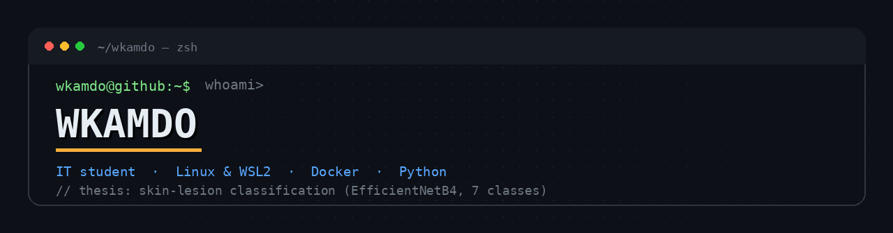

## About

Information Systems student in Indonesia. Most of my time goes to the terminal — WSL2 on
Windows, Docker for anything that should not touch my host, and PHP/Laravel or React when
something has to look like a finished app.

- **Working on:** my thesis, still in progress
- **On the web side right now:** Laravel and React
- **Off the clock:** manga and manhwa — rough translations, mostly for practice
- **Ask me about:** Docker on WSL, or why yesterday's working setup stopped working
- **Reach me:** Discord DM is the fastest (link at the bottom)

## What I build

| Project | What it is |
|---|---|
| **Thesis** | Work in progress — the repository opens after the defense. |
| [Program-menghitung-volume-Balok-dan-Kubus](https://github.com/Wkamdo/Program-menghitung-volume-Balok-dan-Kubus) | First Python exercise, later cleaned up: two plain scripts, then a version with functions, input validation and `unittest` tests. |

## Toolbox

## Coursework

The repositories below are **shared coursework**, not personal projects. They hold submissions
from the whole class (mine included), so I neither modify them nor claim them as my own work:

| Repository | Course |
|---|---|
| [pemrograman-bergerak-4C-2024](https://github.com/Wkamdo/pemrograman-bergerak-4C-2024) | Mobile programming — pull-request practice, one folder per student |
| [sistem-manajemen-basis-data-4B-2024](https://github.com/Wkamdo/sistem-manajemen-basis-data-4B-2024) | Database management systems — folders `modul-1` to `modul-7` |

## Reach me

- **Discord:** [send a DM](https://discord.com/users/512213893054070785) — fastest way to reach me
- **GitHub:** [github.com/Wkamdo](https://github.com/Wkamdo)
- **Lokasi:** Indonesia (WIB / UTC+7)
